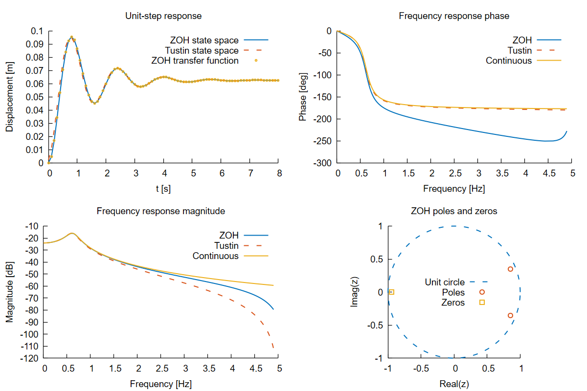

## Controls Module

The `dynamics_controls` module provides continuous-time linear control-system tools:

* `state_space` represents a system as $\dot{x}=Ax+Bu,\; y=Cx+Du$. It has constructors for general matrix systems, second-order mass-damping-stiffness systems, and PID-controlled plants. Its methods evaluate derivatives and outputs and compute poles, zeros, and transfer functions.
* `transfer_function` and `polynomial` represent and combine scalar transfer functions. Transfer functions can be evaluated in the Laplace domain or at a supplied angular frequency, and converted to controllable or observable canonical state-space form.
* `lti_solve` time-integrates a state-space system for a user-supplied excitation callback (`ss_excitation`). An optional ODE integrator and user data can also be supplied.
* `state_space%to_transfer_function` converts a continuous state-space system to a `transfer_function`.

The `dynamics_discrete_controls` module provides discrete-time counterparts that carry a `sample_time`:

* `discrete_state_space` represents $x_{k+1}=Ax_k+Bu_k,\; y_k=Cx_k+Du_k$. It has `poles` and `to_transfer_function` methods.
* `discrete_transfer_function` represents a rational function in $z^{-1}$, $H(z)=Y(z^{-1})/X(z^{-1})$. Its polynomial coefficients are in ascending powers of $z^{-1}$. Its `poles` and `zeros` methods return roots in $z$, and `evaluate` computes the response at an angular frequency in rad/s.
* `discrete_transfer_function%to_ccf_state_space` and `%to_ocf_state_space` convert to controllable and observable canonical form, respectively, preserving the sample time. The denominator's constant term in $z^{-1}$ must be nonzero. Numerators of higher order in $z^{-1}$ are supported, including pure delays. Constant gains yield zero-state models.
* `c2d` discretizes a continuous `state_space` using `DISCRETIZE_ZOH` (zero-order hold, via the matrix exponential) or `DISCRETIZE_TUSTIN` (bilinear transform).
* `d2c` converts a `discrete_state_space` back to continuous time using the same methods. The ZOH inverse uses the principal matrix logarithm, which requires that $A_d$ has no eigenvalues on the negative real axis. Otherwise the routine stops with an error.

## PID Control Example

The [`pid_control_example_1`](../../examples/pid_control_example_1.f90) example closes a PID loop around a mass-spring-damper plant. It uses a square-wave reference, compares the closed-loop output to the command over 0.5 seconds, and evaluates the closed-loop transfer function over 1--1000 Hz.

The example's `model` module defines the plant parameters and the square-wave reference. The mass, damping, and stiffness values are $m=6.0\times10^{-4}$, $b=2\zeta\sqrt{km}$, and $k=2.0\times10^3$; $\zeta=0.3$. The command has amplitude $X=0.5$ and frequency $f=5$ Hz:

```fortran
subroutine command_signal(t, r, args)
    real(real64), intent(in) :: t
    real(real64), intent(out) :: r(:)
    class(*), intent(in), optional :: args

    r = sign(X, sin(2.0d0 * pi * f * t))
end subroutine
```

The core setup creates the second-order plant, wraps it in a closed-loop PID model, and integrates it from rest:

```fortran
use iso_fortran_env, only : real64
use dynamics, only : state_space, ss_excitation, lti_solve
use model, only : m, b, k, X, command_signal

real(real64), parameter :: Kp = 0.551048902d0
real(real64), parameter :: Ki = 1295.323281d0
real(real64), parameter :: Kd = 1.086432759d-3
real(real64), parameter :: tau = 1.369008811d-4
real(real64), parameter :: tmax = 0.5d0
type(state_space) :: plant, mdl
procedure(ss_excitation), pointer :: fcn
real(real64), dimension(4) :: ic
real(real64), allocatable, dimension(:,:) :: sol

plant = state_space(m, b, k)
plant%C = reshape([k * X, 0.0d0], [1, 2])
mdl = state_space(Kp, Ki, Kd, tau, plant)

fcn => command_signal
ic = [0.0d0, 0.0d0, 0.0d0, 0.0d0]
sol = lti_solve(mdl, fcn, [0.0d0, tmax], ic)
```

Here `Kp`, `Ki`, and `Kd` are the proportional, integral, and derivative gains. `tau` sets the derivative-filter time constant in the PID state-space model. The closed-loop model has four states: the plant position and velocity, the integral-error state, and the filtered derivative state. The example plots the output alongside the command; it also computes the model's poles and zeros.

The gains and filter time constant are chosen by matching the closed-loop characteristic polynomial to four real poles at $-1400$, $-1600$, $-2200$, and $-3200$ per second, using the example's scaled displacement output $y=kXq$. This improves nominal square-wave tracking, at the cost of a larger force spike at each command edge. The example does not model actuator limits or sensor noise.


The Bode plot is evaluated at angular frequencies $\omega=2\pi f$, where $f$ spans 1--1000 Hz. The code converts the transfer-function magnitude to dB with $20\log_{10}\lvert H\rvert$ and the phase to degrees.


Build with `BUILD_DYNAMICS_EXAMPLES=ON`, then build and run the `pid_control_example_1` target. The Bode image in the repository is named `pid_control_example_1_bode.png`.

## Discrete State-Space and Transfer Function Example

[`discrete_controls_example`](../../examples/discrete_controls_example.f90) models the displacement of a mass-spring-damper system driven by a unit force. It discretizes the continuous plant with a 0.1 s sample time using both zero-order hold (ZOH) and Tustin, converts each model to a discrete transfer function, and converts both back to continuous time to report round-trip matrix errors.

The ZOH transfer function's coefficients are printed in ascending powers of $z^{-1}$ and used to construct a `discrete_transfer_function` directly. Its poles and zeros are reported in the $z$ plane. The example applies the coefficients in a difference equation and compares the resulting step response with the state-space recurrence and the exact sampled continuous step response. Both simulations start at rest; the Tustin model has direct feedthrough and therefore responds at the first sample.

The four plot panels show the sampled step responses, ZOH poles and zeros relative to the unit circle, and the magnitude and phase of the ZOH, Tustin, and continuous frequency responses. Discrete responses are evaluated at $z=e^{i\omega T_s}$ up to 4.9 Hz, just below the 5 Hz Nyquist frequency; the ZOH phase is unwrapped. The ZOH step samples match the continuous response for a held input, while the Tustin frequency response shows the effects of bilinear frequency warping.



Build with `BUILD_DYNAMICS_EXAMPLES=ON`, then build and run the `discrete_controls_example` target.