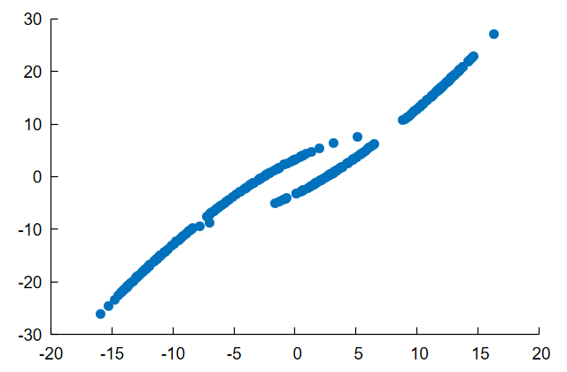
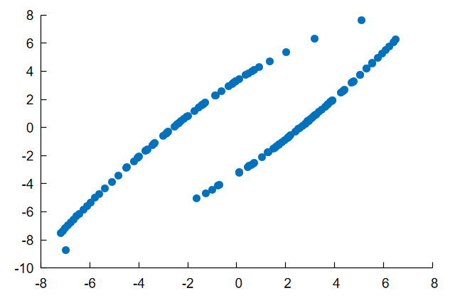
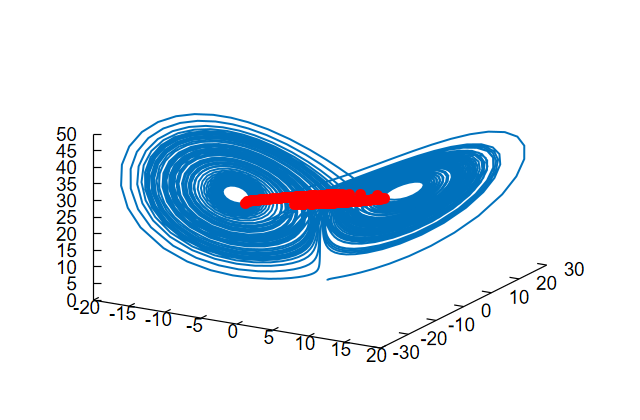
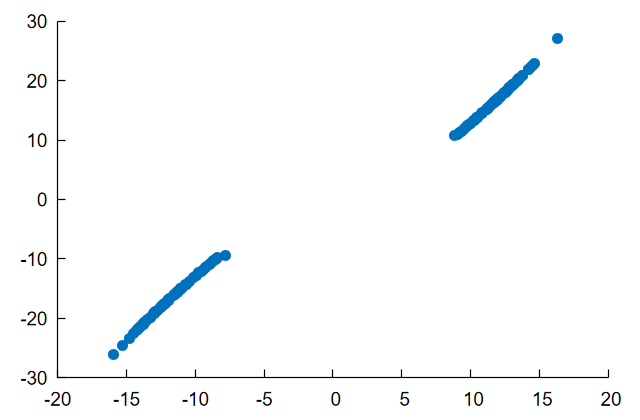
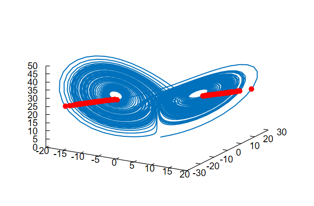
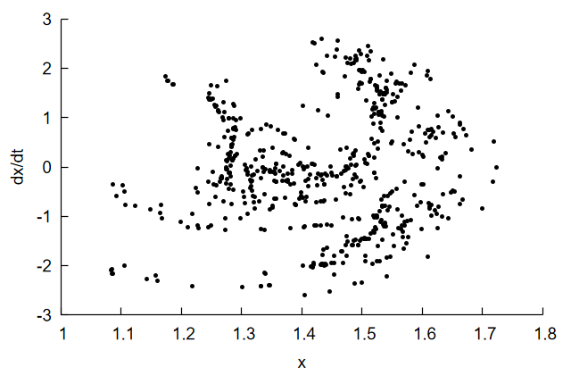
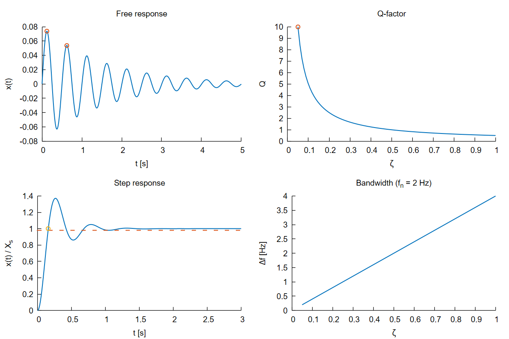

## Vibration Analysis Modules

* [`dynamics_vibrations`](dynamics_vibrations.f90) provides vibration and transient-response metrics, including quality factor, bandwidth, damping from logarithmic decrement or overshoot, and helpers for analyzing free and step responses.
* [`dynamics_stability`](dynamics_stability.f90) classifies fixed points from the eigenvalues of the linearized dynamics matrix. Eigenvalues with zero real part may require further nonlinear analysis.
* [`dynamics_maps`](dynamics_maps.f90) extracts Poincaré sections from either a sampled trajectory or an ODE model. It interpolates crossings between samples and can retain both crossing directions or only crossings from a specified side of the plane.

A Poincaré section records where a trajectory crosses a surface instead of plotting the entire time history. The Poincaré examples below show how to use a geometric plane to slice an existing trajectory and how to sample a periodically forced oscillator at a fixed forcing phase.

## Lorenz System: Section of a Sampled Trajectory

[`poincare_example`](../../examples/poincare_example.f90) integrates the Lorenz equations and slices the trajectory at $z=25$. The `plane` constructor takes a point on the plane and a normal. The first column of `sol` holds time; the next three hold $x$, $y$, and $z$.

```fortran
pln = plane([0.0d0, 0.0d0, 25.0d0], [0.0d0, 0.0d0, 1.0d0])
mdl%fcn => eom
call integrator%solve(mdl, [0.0d0, 1.0d2], [1.0d0, 0.0d0, 1.0d0])
sol = integrator%get_solution()
map = poincare_map(sol(:,2), sol(:,3), sol(:,4), pln)
```

The call above uses the default two-sided section. Set `side = POINCARE_ONE_SIDED_FROM_FRONT` to keep crossings from $z>25$, or `side = POINCARE_ONE_SIDED_FROM_BACK` to keep crossings from $z<25$. The returned array has one row per retained intersection and three columns for its coordinates. Plot the first two columns for a view of the section, or overlay all three on the original trajectory.

| Crossing selection | Section in the $xy$ plane | Section overlaid on the trajectory |
| --- | --- | --- |
| Two-sided (default) |  |  |
| From the front |  |  |
| From the back |  |  |

## Duffing Oscillator: Fixed-Phase Section

[`duffing_poincare_example`](../../examples/duffing_poincare_example.f90) models a damped, periodically forced Duffing oscillator. It adds forcing phase $\phi$ to the displacement and velocity state, with $\dot{\phi}=\omega$, so the forcing can be evaluated as $\gamma\cos\phi$. The section-coordinate callback returns `[state(1), state(2), sin(state(3))]`, so the default section plane selects zeros of $\sin\phi$. Keeping only crossings from the back selects phase zero modulo $2\pi$, rather than also sampling a half-period later.

```fortran
model%fcn => duffing_eom
call integrator%solve(model, [0.0d0, 0.5d0 * transient_end, &
    transient_end], [0.0d0, 0.0d0, 0.0d0])
transient_solution = integrator%get_solution()

section = poincare_map(model, [transient_end, response_end], &
    transient_solution(3,2:4), response_points, &
    side = POINCARE_ONE_SIDED_FROM_BACK, solver = integrator, &
    chunk_size = 20 * points_per_cycle, &
    coordinates = duffing_section_coordinates)
```

The example discards the first 50 forcing cycles, then analyzes 50,000 cycles at 50 sample intervals per cycle. The ODE overload processes the trajectory in chunks rather than storing the full history. The plot shows displacement versus velocity at the retained crossings; the markers are fixed-phase samples, not a continuous trajectory.



## Pendulum Stability: Linearized Equilibria

[`stability_example`](../../examples/stability_example.f90) linearizes the pendulum equation $\ddot{\theta} = -(g/L)\sin\theta - c\dot{\theta}$ about its equilibria. With state $[\theta, \dot{\theta}]$, the dynamics matrix at $\theta=0$ is $\begin{bmatrix}0 & 1\\ -g/L & -c\end{bmatrix}$. At $\theta=\pi$, the $-g/L$ entry becomes $+g/L$. `determine_local_stability` returns one of the fixed-point classification constants from the eigenvalues of that matrix:

```fortran
flag = determine_local_stability(a_, ev = ev)
select case (flag)
case (HYPERBOLIC_FIXED_POINT_SINK)
    name = "Hyperbolic sink (stable)"
case (HYPERBOLIC_FIXED_POINT_SADDLE)
    name = "Hyperbolic saddle (unstable)"
! ...
end select
```

The example classifies the damped bottom equilibrium as a sink, the damped top equilibrium as a saddle, the undamped bottom equilibrium as a center, and the negative-damping bottom equilibrium as a source. A free mass with viscous damping, $\dot{x}=v$ and $\dot{v}=-cv$, has a zero eigenvalue and is classified as neutrally stable. Eigenvalues with zero real part make the point nonhyperbolic, so the linearization alone cannot settle its stability.

## Vibration Helpers: Free, Step, and Sweep Metrics

[`vibrations_helper_example`](../../examples/vibrations_helper_example.f90) illustrates the helper routines in `dynamics_vibrations` for a 2 Hz second-order system. It uses `find_free_response_properties`, `logarithmic_decrement`, and `damping_from_log_decrement` on a free response, `rise_time`, `find_settling_amplitude`, and `damping_from_fractional_overshoot` on a step response, and `q_factor` and `estimate_bandwidth` over a range of damping ratios. The printed values match the analytic results to within the sampling resolution.



The figure has four panels:

* **Free response (top left):** The decaying response $x(t)$ with $\zeta=0.05$. The two open circles mark the first two peaks detected by `find_free_response_properties`. Their spacing gives the damped period, and the ratio of their amplitudes gives the logarithmic decrement.
* **Step response (bottom left):** The normalized step response $x(t)/X_s$ with $\zeta=0.3$. The open circle marks the rise time, where the response first reaches the final value. The dashed line is the settling amplitude estimated from the sampled response. The overshoot peak above this line is used to estimate $\zeta$.
* **Q-factor (top right):** $Q$ versus $\zeta$ from `q_factor`. The circle marks the value at the free-response damping ratio, $Q=10$ at $\zeta=0.05$.
* **Bandwidth (bottom right):** The half-power bandwidth $\Delta f$ in hertz versus $\zeta$ from `estimate_bandwidth`. The bandwidth grows linearly with $\zeta$, reaching 0.2 Hz at $\zeta=0.05$.

To build the examples, configure CMake with `BUILD_DYNAMICS_EXAMPLES=ON` and build the `poincare_example`, `duffing_poincare_example`, `stability_example`, and `vibrations_helper_example` targets.